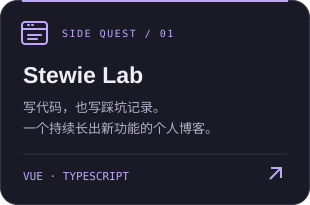
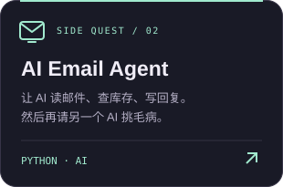
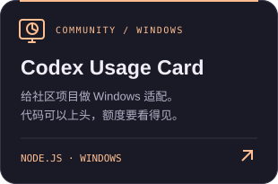

  

  <a href="https://stewie.fun"><b>🪐 我的博客 · stewie.fun ↗</b></a>
  &nbsp;&nbsp; / &nbsp;&nbsp;
  <a href="https://github.com/zssz666?tab=repositories">🕹️ 探索我的项目</a>

### 👾 PLAYER 01 · 关于我

我是 **stewie**，一个喜欢给生活写补丁的全栈工程师。

前端、后端、AI、自动化都折腾。看到重复操作想写脚本，看到新点子想建仓库。

> **主线任务**：把东西做好。 **支线任务**：看看还能加点什么。
>
> **隐藏关卡**：修好刚加的东西。

### 🎒 LOADOUT · 当前装备

  

### 🛸 SIDE QUESTS · 已解锁的支线

  
  
  

卡片可以点击。Bug 暂不支持点击消除。

### 🐍 BONUS LEVEL · 小蛇来清场

  <picture>
    <source media="(prefers-color-scheme: dark)" srcset="assets/snake/snake-dark.svg" />
    <source media="(prefers-color-scheme: light)" srcset="assets/snake/snake.svg" />
    
  </picture>

今天的代码，明天的口粮。根据我的真实贡献记录，每天自动刷新。

🧩 点击领取一条开发者冷知识

“我就改一行。”

—— 每个新支线任务的开场白。

---

  <b>不一定每次都一次跑通，但每次都想做点有意思的。</b> 
  感谢路过。下一站：<a href="https://stewie.fun">stewie.fun</a> 🚀

